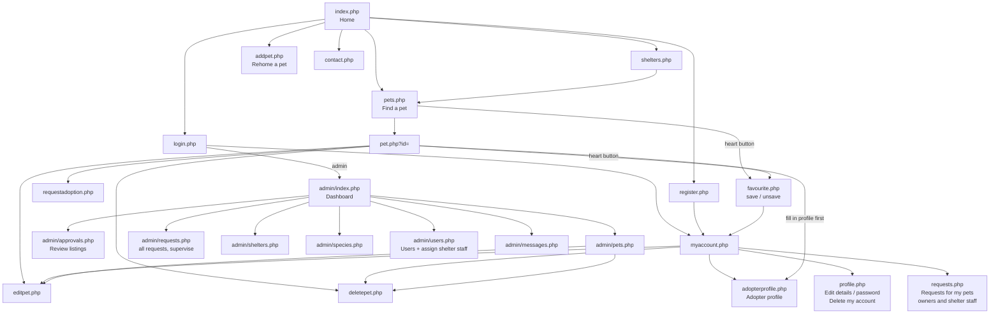

# Navigation structure

Pages that need a login: favourite, profile, adopterprofile, requests, addpet, editpet, deletepet, requestadoption, myaccount. Admin pages need the admin role.

Who answers an adoption request: the **owner** of a private rehoming pet, or the **staff of the pet's shelter** (`requests.php`).
Admins see every request in `admin/requests.php` and step in when a shelter has no staff or an owner's account was deleted.
Nobody can send a request for a pet they manage themselves.

A member can create an account (register.php), edit it (profile.php) and delete it (profile.php, with the password and a confirmation).
Deleting removes the member's adopter profile, favourites, the requests they sent and their private pets with photos; pets listed for a
shelter stay. Admin accounts cannot delete themselves (the site always keeps at least one admin); another admin removes them.
